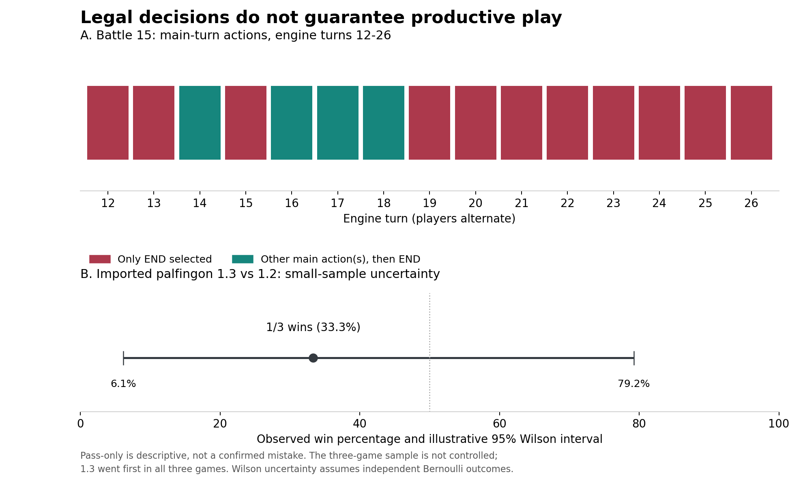

# Retrospective Data Audit

Snapshot: September 9, 2026, local time. This is an audit of existing files,
not a new tournament. Agent code and archived submissions were not changed.
The accompanying CSV/JSON files contain aggregate metrics, not private hands
or decoded engine search state.

## Scope and Reproduction

From the project root:

```sh
python3 -B "write ups/analyze_writeup_data.py"
python3 -B -m unittest discover -s "write ups" -p "test_analyze_writeup_data.py" -v
```

The script uses only Python's standard library. It reads simulator summaries,
decision JSONL files, and invalid-response sidecars. Generated outputs:

- `data/match_inventory.csv`: one row per saved summary, with versions/seats,
  outcome, counts, trace coverage, and pass-only metrics.
- `data/turn_metrics.csv`: one row per observed player/main turn.
- `data/audit_summary.json`: totals, comparison results, missing-data findings,
  and SHA-256 manifest of audited inputs and the script.

Rerunning includes any newly saved matches. These narrative tables describe
this snapshot and should be reviewed after regeneration. Hashes preserve input
provenance for this audit, not historical source provenance at match time.

## Data Inventory

| Quantity | Observed value | Interpretation |
| --- | ---: | --- |
| Saved match summaries | 41 | Not 41 fully verified games |
| Nonempty episodes linked to summaries | 40 | One summarized episode has zero decisions |
| Summaries with an identified winner | 39 | Two have null winner; do not label them draws |
| Decisions in linked episodes | 5,943 | Both agents, including random |
| Valid recorded selections | 5,943 / 5,943 | Index, uniqueness, and count checks |
| Invalid-response sidecars present | 41 / 41 | All empty |
| Raw invalid-response records | 0 | No such violations recorded in this sample |
| Non-null summary errors | 0 | Not a universal crash/timeout guarantee |
| Unsummarized episode files | 5 | All empty; outcome unavailable |
| Summary/episode count or identity inconsistencies | 0 | Checks implemented by the audit |
| Observed main turns | 1,157 | Includes old imports and random agents |
| Pass-only main turns | 411 | A descriptive flag, not 411 proven mistakes |
| Turns selecting an engine attack option | 233 | Option-type metric, not damage/KO success |

All 41 summaries say `terminal observation`, but two have no winner and one
has no decisions. In the runner, `done` can be true for a termination reason
without a winner. Five additional empty episodes lack summaries. We cannot
infer their causes or treat these files as successful completions.

The saved decision stream contains **validated** choices. The runner may
substitute a fallback after an invalid raw response; those responses have a
separate sidecar. Checking both streams is necessary. The audit does not
prove absence of silently handled policy errors, aborted sessions, or failures
before recording began. Decision rows are correlated within matches.

## Decision Trace Coverage

| Recorded agent identity | Decisions | Nonempty traces |
| --- | ---: | ---: |
| Workspace Hydreigon/Gengar | 151 | 151 |
| Workspace Palaking | 1,566 | 586 |
| Workspace N's Zoroark | 70 | 0 |
| Workspace palfingon | 1,309 | 1,309 |
| Imported submission 11.5 | 9 | 9 |
| Imported Palaking 1.25 | 323 | 205 |
| Imported palfingon 1.1 | 355 | 355 |
| Imported palfingon 1.2 | 831 | 831 |
| Imported palfingon 1.3 | 186 | 186 |
| Random | 1,143 | 0 |

A nonempty trace is not necessarily a complete score explanation. Missing
traces prevent retrospectively attributing every action to an internal rule.
Workspace paths are mutable: do not assign all historical `palfingon/agent.py`
runs to version 1.3. Imported paths identify a version and an archive-hash
prefix, but historical per-run source/deck hashes were not recorded.

## Pass-Only Behavior



Figure: battle 15's turn actions and the imported 1.3-vs-1.2 sample. Both
panels are descriptive; they are not a controlled before/after experiment.
No card artwork is used. Regenerate after the audit with
`MPLCONFIGDIR=/tmp/ptcg-writeup-matplotlib python3 -B "write ups/plot_writeup_data.py"`.
Only this optional plotting script requires Matplotlib; the audit does not.

Definition: group recorded observations by match, player, and engine turn;
keep legal-choice windows with main context `0`. A turn is pass-only if its
selected main actions are exclusively END (`14`). A turn that attaches Energy
and then ends is not pass-only. Attack-option turns contain type `13`.

Own-turn streaks require consecutive engine turns separated by exactly two;
missing observations break a streak. Required effect prompts are not counted
as voluntary main actions. These constants are checked against
`palfingon/state_eval.py`; revisit them if the engine schema changes.

| Example | Decisions | Observed main turns | Pass-only | Longest own-turn streak |
| --- | ---: | ---: | ---: | --- |
| Battle 15, imported 1.1 mirror | 206 | 41 | 12 | 4 for each player |
| Battle 24, imported 1.2 mirror | 186 | 19 | 0 | 0 |
| Battles 31-33, imported 1.3 vs 1.2 | 329 | 43 | 0 | 0 |

In battle 15, turns 12-26 contain 15 END selections, but only 11 pass-only
turns: turns 14, 16, 17, and 18 include other main actions. Turns 19-26 form
eight consecutive pass-only engine turns, four per player. This makes the
reported stall concrete without conflating every END with inactivity.

One historical Palaking 1.25 import accounts for 288 of the 411 pass-only
turns, out of its 298 observed main turns. This merits targeted diagnosis;
it makes the pooled pass rate unsuitable as a measure of the latest agent.
No causal diagnosis of that import is made by this audit.

**No pass-only turns is not equivalent to good play:** a policy can waste
resources and still satisfy this metric. Conversely, passing can be correct.
Use expert review or controlled continuation to identify avoidable passes.

## Version Comparison: Include the Losses

These three matches use imported palfingon 1.3 in seat 0 and 1.2 in seat 1.
Version 1.3 went first in all three.

| Match | Decisions | Engine turns | Winner | 1.3 result |
| --- | ---: | ---: | --- | --- |
| battle31_15-50_2026-09-09_sub_vs_sub | 34 | 5 | 1.3 | Win |
| battle32_15-56_2026-09-09_sub_vs_sub | 143 | 18 | 1.2 | Loss |
| battle33_16-04_2026-09-09_sub_vs_sub | 152 | 20 | 1.2 | Loss |

Version 1.3 won **1/3 (33.3%)**. An illustrative 95% Wilson interval is
**6.1%-79.2%**, conditional on independent Bernoulli sampling. Seat/first-player
imbalance and convenience sampling remain uncorrected. This neither proves
1.3 improved nor establishes that it is reliably weaker.
[Wilson method: NIST](https://www.itl.nist.gov/div898/handbook/prc/section2/prc241.htm).

Earlier smoke matches 29 and 30 gave workspace palfingon **2/2** wins against
random, with seat assignments reversed. Palfingon nevertheless went first in
both, so this was **not** a balanced going-first/second experiment. Its
illustrative Wilson interval is 34.2%-100%. Different opponents and uncertain
workspace version provenance prohibit treating 100% versus 33.3% as a version
performance delta.

These small samples illustrate why interval estimates and repeated evaluation
matter; deep-RL evaluation research supplies methodological context, not
independent evidence about this game.
[Agarwal et al., 2021](https://arxiv.org/abs/2108.13264).

## Other Evidence: Keep the Denominators Separate

| Evidence | Recorded/rechecked result | Limitation |
| --- | --- | --- |
| Historical source checks | 36 Hydreigon/Gengar; 10 Palaking; 17 N's Zoroark tests passed | Focused suites, not all archived versions |
| Current palfingon suite | 215 tests passed | Prior editorial recheck, not 215 games |
| Battle 24 annotation audit | 13/14 exact choices; remaining case passes intended continuation | Development examples, not held-out labels |
| Battle 24 full-policy recheck | 186 selectable observations, no fallback exceptions reported | Saved-state recheck, not counterfactual full games |
| Recorded decision timing | Median 6.47 ms, p95 74.06 ms, max 99.57 ms | Local replay calls; excludes engine and IPC |
| New audit-script tests | 8 tests passed | Tests the audit, not the agent |

Sources: `CROSS_DECK_EVIDENCE.md`, `palfingon/docs/BATTLE_REVIEW_1.3.md`,
and `palfingon/docs/STALL_FIX_1.2.md`. Timing is previously documented, not
freshly benchmarked here. JSONL timestamps are recording times and cannot
be substituted for agent latency. Human-reviewed examples were used for
development; 13/14 is not a generalization accuracy estimate.

## Next Evaluation: Proposed, Not Yet Run

1. Freeze ZIP, agent source, deck, engine, and rule-checkpoint hashes. Record
   machine, runtime, adapter, clock limits, and legal metadata version.
2. Compare frozen 1.2 and 1.3 first. Use a fixed budget, initially 100 games
   each going-first condition where the engine permits; keep the intended
   deployment's opening policy separate from forced-first experiments.
3. Log game RNG seeds if genuinely supported. A seeded random opponent alone
   does not seed deck order. If seeds cannot be fixed, say so; do not call
   unmatched runs paired experiments.
4. Expand to random, sample agents, frozen older submissions, and multiple
   opposing decks. Specify weights before calculating an aggregate result.
5. Report wins/losses/draws, unfinished games, timeout/crash counts, raw illegal
   outputs, fallback counts, and agent-only latency separately. Keep failed
   attempts in the accounting rather than silently dropping them.
6. Record time to first attack, setup completion, surplus Energy, and
   expert-confirmed missed opportunities with explicit opportunity denominators.
   At present these are proposed metrics, not numbers this audit established.
7. Run ablations of structured memory, coordinated movement, pre-attack
   sequencing, and discard-cost bundles. Keep everything else fixed and report
   interactions; disabling a guard can change future state distributions.
8. Split any future training data by entire match, with held-out opponents or
   deck families. Keep adjacent decisions and replays of the same game together.

For scale only: at an observed 50% win proportion, 200 independent games give
approximately +/-6.9 percentage points of Wilson uncertainty; 400 give
approximately +/-4.9. These are precision illustrations, not power guarantees
for detecting a particular improvement or permission to ignore match pairing.
