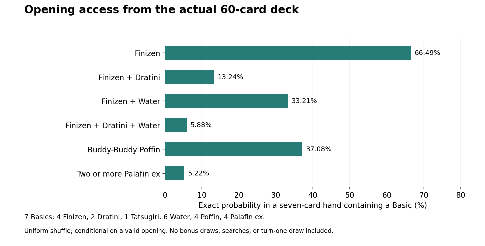

# Cross-Deck Methods and Results

The primary article is [cross-deck strategy draft v8](cross_deck_strategy_draft_v8.md).
The [Palafin ex deck's later-series 1.3 logic map](PALFINGON_CURRENT_LOGIC.md)
is a technical appendix. Original archive names below preserve provenance.
Measurements below remain scoped to their actual decks, versions and samples;
the fixed-state ablation tests the Palafin ex deck's later series, not all three
deck strategies.
The [approval catalog](PAPER_APPROVAL_CATALOG.md) records 17 approved papers
and seven exclusions. The article uses only approved papers. Citations in
this historical research supplement are not automatically article references.

## Evidence and Experimental Units

This analysis separates exact deck calculations, measurements from saved games,
and newly executed fixed-observation experiments. None is presented as neural
training. The game rules and legal options remain supplied by cabt; the equations
below describe policy diagnostics, resource requirements, and statistical models.

The historical corpus contains 41 summaries, 40 nonempty linked episodes, and
5,943 decisions. Thirty-nine summaries identify a winner. Two do not, and five
additional empty episodes lack summaries. These incomplete records cannot be
classified as successful games. The preceding audit and its CSV inventory
document the inclusion criteria.[^1]

New experiments use the archived palfingon 1.1, 1.2, and 1.3 submissions, not
mutable workspace copies. The archives are extracted into temporary directories
and imported in separate Python processes. Their hashes and the original input
hashes accompany the results. The experiment does not change a submission ZIP
or installed agent.

There are **29 distinct test observations**: 14 expert-reviewed battle-24
windows and 15 battle-15 END windows from turns 12-26. Four configurations,
each repeated three times, produce **348 calls**. Repeated calls test
determinism; they do not create 348 independent strategic examples.

## 1. Constrained Selection and Score Discordance

For observation $o_t$, let $n_t$ be the number of legal options and let
$m_t,M_t$ be the required minimum and maximum selection counts. The admissible
index subsets are

$$
\mathcal C(o_t)=\{I\subseteq\{0,\ldots,n_t-1\}:m_t\leq|I|\leq M_t\}.
$$

The submission returns a list representing a member of this set. This describes
ordinary legal-choice windows, not the separate setup/deck-loading handshake.
The audit independently checks integer indices, uniqueness, range, and count.

The implemented policy is not simply a global argmax. It is more accurately
described as $I_t=G(o_t,h_t,s_t,\mathcal C(o_t))$, where $h_t$ is explicit match
memory, $s_t$ is the heuristic score vector, and $G$ includes forced prompts,
finishing checks, preparation checks, and other branch priorities. Restricting
choices to legal options is related to action masking, but no policy-gradient
training is used here.[^2]

For a single selected action $a_t$, define a diagnostic score gap:

$$
\delta_t=\max_{a\in A(o_t)}s_t(a)-s_t(a_t),\qquad
D=\frac{1}{N}\sum_{t=1}^{N}\mathbf 1[\delta_t>10^{-9}].
$$

Only main-phase windows with at least two options, exactly one selected index,
a complete finite score vector, and matching trace/recorded selection are
eligible. Tied maximum scores are not discordance. Scores are not comparable
across arbitrary decks or versions, so the raw gap is a within-window quantity.

| Recorded identity | Eligible scored windows | Discordant | Percentage |
| --- | ---: | ---: | ---: |
| Imported palfingon 1.1 | 207 | 73 | 35.27% |
| Imported palfingon 1.2 | 446 | 131 | 29.37% |
| Imported palfingon 1.3 | 99 | 27 | 27.27% |
| Historical Palaking 1.25 import | 195 | 195 | 100.00% |
| All eligible recorded identities | 2,075 | 729 | 35.13% |

These are descriptive distributions over different visited states, not a
controlled improvement curve. A final-prize override or a resource-preservation
guard may intentionally select below the score maximum. Discordance is neither
an error label nor reinforcement-learning regret. Missing traces are excluded,
not counted as agreement.

One annotated case makes the diagnostic concrete. Battle 24, decision 131,
assigned Poffin 32,557.5 and Giga Impact -3,780, yet selected the attack:

$$\delta_{131}=32{,}557.5-(-3{,}780)=36{,}337.5.$$

The expert separately requested Poffin at that window. Here, the score gap and
the annotation agree that control flow requires inspection. The later ablation
tests which execution check controls the choice; the score alone does not
establish the correct move.[^3]

## 2. Opening Access as Conditional Combinatorics

The verified 60-card list contains four Finizen, two Dratini, one Tatsugiri,
six Water Energy, four Poffin, and four Palafin ex. The catalog marks the first
three species as Basic: **seven Basics total**. The three archived versions
have the same deck multiset. Palafin ex is not a Basic; confusing that category
would substantially distort opening calculations.[^4]

For $K$ desired cards in $N$ cards, drawing $h$ without replacement gives

$$P(X=k)=\frac{\binom Kk\binom{N-K}{h-k}}{\binom Nh}.$$

This is the hypergeometric model.[^5] For a uniformly shuffled first seven,
with $B$ denoting at least one Basic,

$$P(B)=1-\frac{\binom{53}{7}}{\binom{60}{7}}=0.60087955.$$

Thus the model gives 39.91% probability of a first attempted hand requiring a
mulligan. That is not a 39.91% loss rate. Accepted opening hands are conditioned
on $B$, so using unconditioned seven-card probabilities afterward is incorrect.

The same calculation exposes a cross-deck construction tradeoff. The following
uses the current 60-card CSV in each workspace, classified by the same
organizer-derived catalog; these are deck-composition snapshots, not inferred
historical match versions:

| Workspace | Basics | Initial mulligan probability | Focal Basic, copies | Focal Basic in accepted seven |
| --- | ---: | ---: | --- | ---: |
| Hydreigon/Gengar | 9 | 29.98% | Deino, 3 | 45.05% |
| Palaking | 7 | 39.91% | Finizen, 4 | 66.49% |
| N's Zoroark | 13 | 16.28% | N's Zorua, 4 | 47.72% |
| Palfingon | 7 | 39.91% | Finizen, 4 | 66.49% |

The focal species is a calculation target, not a claim that every opening
must make it Active. More Basics reduce mulligans, but also allow more accepted
hands without the focal evolution line. Palafin and Zoroark each have four
copies of their focal Basic, yet their conditional access probabilities differ.
Neither Basic density nor focal access alone ranks overall deck strength.

For disjoint desired groups $G_1,\ldots,G_r$ with sizes $K_1,\ldots,K_r$,
inclusion-exclusion gives

$$
P(\text{each present})=
\sum_{J\subseteq\{1,\ldots,r\}}(-1)^{|J|}
\frac{\binom{60-\sum_{j\in J}K_j}{7}}{\binom{60}{7}}.
$$

If the event includes Finizen, it already implies $B$; divide that event's
probability by $P(B)$ to condition on an accepted hand. For Poffin or multiple
ex cards, the numerator must instead explicitly require a Basic. Multiplying
individual access probabilities assumes independence that sampling without
replacement does not provide.

| Accepted seven-card event | Exact model | Identifiable recorded hands |
| --- | ---: | ---: |
| Finizen present | 66.49% | 10/20 |
| Finizen and Dratini | 13.24% | 4/20 |
| Finizen and Water | 33.21% | 7/20 |
| Finizen, Dratini, and Water | 5.88% | 3/20 |
| Poffin present | 37.08% | 4/20 |
| At least two Palafin ex | 5.22% | 0/20 |



The empirical column uses only imported palfingon setup observations with seven
known cards and an empty board before choosing Active. It is a selected sample
of 20 hands, sometimes from opposite sides of the same match. It is not an
independent goodness-of-fit test, and the exact model is not fitted to it.
The model excludes opponent-mulligan bonus cards, the turn draw, searches, and
other card effects. It does not reveal hidden Prizes.

The strategic implication is limited but useful: waiting for the two setup
lines and Water to arrive naturally in the accepted opening is unreliable.
This supports a design that recovers from incomplete combinations. It does
not quantify attack-by-turn-two probability or prove the chosen search policy
is optimal. Catalog data also distinguish Dratini's 80 HP from Finizen's and
Tatsugiri's 70 HP, explaining why the same Basic-search route cannot serve all
three targets.[^4]

## 3. Typed Energy Deficit

Let $c_{p,e}$ be the Basic Energy units of type $e$ required for the selected
attack of Pokemon $p$, and $a_{p,e}$ its attached units. Define

$$d(p)=\sum_e\max(c_{p,e}-a_{p,e},0).$$

In this audited list, Giga Impact has $c=(1\ Water)$ and Ryuno Glide has
$c=(1\ Water,2\ Lightning)$. A Lightning attachment does not reduce Palafin
ex's Water deficit; three Water do not satisfy Dragonite's two-Lightning
requirement. Metadata records 250 and 330 base damage respectively, with the
latter discarding two Energy.[^4]

The deficit function deliberately excludes special Energy, cost modifiers,
attack-copy effects, and other decks' different requirements. Even here,
$d(p)=0$ means **Energy-sufficient**, not legally able or strategically ready
to attack: Active position, previous-turn restrictions, and effects still
matter. The N's Zoroark policy therefore cannot inherit Palafin's cost vector.

Measurements take the last recorded main-choice observation for each player
turn. Each sighting of each owned Palafin ex is one snapshot:

| Imported version | Palafin ex snapshots | More than one Energy | Non-Water present | Water requirement satisfied |
| --- | ---: | ---: | ---: | ---: |
| 1.1 | 61 | 0 | 0 | 50 |
| 1.2 | 89 | 0 | 0 | 66 |
| 1.3 | 25 | 0 | 0 | 11 |

These 175 snapshots support the observed Energy-cap behavior, not a universal
guarantee. They repeatedly include the same Pokemon, and a last main-choice
snapshot is not necessarily the final state after an attack resolves. The
latest sample also shows that avoiding excess investment is not equivalent
to funding every attacker: 14/25 sightings lack the required Water. Some are
legitimate unpowered backups, so this is not automatically an error count.

## 4. Passing as a Sequential Diagnostic

Let $z_{p,r}=1$ if player $p$'s recorded main actions on own turn $r$ consist
only of END. Define the pass-only proportion $R=\sum z/T$ and the longest
contiguous own-turn run $L$. A turn with an attachment followed by END has
$z=0$; mandatory prompts and unobserved turns do not establish voluntary
activity or inactivity.

Battle 15 has $R=12/41=29.27\%$ across both players' main turns. Turns 19-26
are eight consecutive pass-only engine turns, four own turns for each player.
This is more precise than counting every END selection as a frozen turn.

For adjacent observations of the same player, separated by exactly two engine
turns, let $N_{ij}$ count $z_r=i,z_{r+1}=j$:

$$
\widehat P(z_{r+1}=1\mid z_r=1)=\frac{N_{11}}{N_{10}+N_{11}}
=\frac7{12}=58.33\%,
$$

$$
\widehat P(z_{r+1}=1\mid z_r=0)=\frac{N_{01}}{N_{00}+N_{01}}
=\frac5{27}=18.52\%.
$$

The underlying counts are $N_{00}=22,N_{01}=5,N_{10}=5,N_{11}=7$.
These are empirical transition frequencies from one battle, not proof of a
stationary Markov process or a causal effect of passing. The concentration
of adjacent pass turns motivates inspecting state history and recovery routes
rather than assuming isolated random mistakes.

## 5. Controlled Decision-Level Ablation

The manipulation disables only `core.reviewed_turn_planner.before_commit_choice`
inside a temporary 1.3 process. The score calculation, remaining guards, deck,
and input observations stay unchanged. It is **not** an ablation of every
sequencing mechanism. Each call resets the match-memory object; metadata
caches persist within the process. Inputs are deep copies of the originals.

For paired observations $o_i$, define the decision-change fraction

$$
\Delta_{\mathrm{choice}}=\frac1n\sum_i
\mathbf1[\pi_{\mathrm{full}}(o_i)\ne\pi_{\mathrm{ablated}}(o_i)].
$$

| Configuration | Exact original expert index /14 | Regression target /14 | END retained in 15 saved END windows |
| --- | ---: | ---: | ---: |
| Archived 1.1 | 2 | 2 | 15 |
| Archived 1.2 | 0 | 0 | 0 |
| Archived 1.3, pre-commit check disabled | 8 | 8 | 0 |
| Archived 1.3, full | 13 | 14 | 0 |


Six of 14 reviewed choices change, so $\Delta_{\mathrm{choice}}=42.86\%$.
The affected decisions are:

| Decision | Full 1.3 | Check disabled |
| --- | --- | --- |
| 79 | Petrel | Attack |
| 82 | Attach Water to Dragonite | Attack |
| 98 | Tatsugiri Ability | Retreat |
| 131 | Poffin | Attack |
| 136 | Attach Water to Dragonite | Attack |
| 141 | Poffin | Attack |

All 348 calls returned valid indices. No instrumented adapter fallback or
outer adapter exception occurred, and each input/configuration returned the
same choice across its three repetitions. This is a narrow stability check,
not formal verification of every internal branch.

The distinction between the two target columns matters. Decision 136's original
annotation requested Petrel first; the implementation's regression target
attaches Water first and then checks Petrel in a continuation test. Relabeling
that difference as exact human agreement would inflate the result. The 14
windows were selected because the expert requested corrections, so 1.2's 0/14
is unsurprising selection bias, not its general decision accuracy.

The ablation establishes that the preparation check changes those six decisions
on fixed inputs. It does not establish a 42.86% performance gain. Disabling it
also leaves the battle-15 END-window correction intact, helping distinguish
that earlier movement recovery from the later pre-commit mechanism.

## 6. What These Experiments Cannot Estimate

Policy value concerns trajectories, not just action agreement:

$$V(\pi)=\mathbb E_{\tau\sim\pi}[\mathbf1(\text{win})].$$

The fixed-observation experiment does not sample trajectories from each revised
policy. After a changed action, the original future hand, board, and opponent
response may no longer follow. Off-policy evaluation research formalizes this
distribution problem; no doubly robust or importance-weighted value estimator
was fitted here.[^6]

The three actually recorded imported 1.3-vs-1.2 matches give one win and two
losses for 1.3, with 1.3 first in every match. Its illustrative 95% Wilson
interval is 6.1%-79.2%, conditional on independent Bernoulli sampling.[^7]
Convenience sampling and first-player imbalance remain. These game results
cannot be replaced by the 14-window regression score. Reporting uncertainty
and unfavorable outcomes follows established evaluation guidance.[^8]

No broad claim of improvement is warranted. Stronger evidence would require
frozen source/deck/engine identities, balanced first-player conditions, a wider
opponent pool, retained failure records, and full-game ablations. Whole matches
must remain intact when separating development and held-out evaluation.

## Reproduction and Files

From the project root:

```sh
python3 -B "write ups/scientific_analysis.py"
python3 -B "write ups/probe_archived_policies.py"
python3 -B "write ups/render_scientific_evidence.py"
python3 -B -m unittest discover -s "write ups" -p "test_*.py" -v
```

The calculations and archive probes use the standard library. Figure/workbook
rendering uses the locally installed Matplotlib and openpyxl. The probe accepts
`--annotations PATH` for the original battle-review export. No engine service,
network, or API key is needed to reproduce these fixed-observation experiments.

`scientific_data/scientific_evidence.xlsx` contains numerical chart data, exact
fractions and spreadsheet verification formulas, every probe response, the
score-window inventory, Energy snapshots, source references, and input hashes.
CSV/JSON equivalents are retained. The eight existing audit tests and six new
scientific-analysis tests pass, including exhaustive small-deck comparisons of
the probability formulas.

## Sources

[^1]: Local corpus: `cabt-local-simulator/data/summaries/` and `data/episodes/`; inclusion and missing-data details in [DATA_AUDIT.md](DATA_AUDIT.md). Derived counts and hashes: `scientific_data/scientific_summary.json`.
[^2]: Huang, S., and Ontanon, S. (2022). [A Closer Look at Invalid Action Masking in Policy Gradient Algorithms](https://arxiv.org/abs/2006.14171). FLAIRS 35. Methodological comparison, not an implemented learning algorithm.
[^3]: Local battle `battle24_11-21_2026-09-09_sub_vs_sub`, decision 131, and its original expert review export. Numeric trace: `scientific_data/score_discordance.csv`; archived responses: `scientific_data/archive_probes.json`.
[^4]: Organizer-derived local metadata: `palfingon/cabt_cards.json`, `cabt_attacks.json`, and `deck.csv`. IDs 105, 902, 122 identify the Basics; attacks 134 and 1302 identify the audited costs. File hashes are recorded with the calculations.
[^5]: SciPy developers. [Hypergeometric distribution documentation](https://docs.scipy.org/doc/scipy/reference/generated/scipy.stats.hypergeom.html). Exact sampling-without-replacement formula; our implementation uses Python integer combinations and rational arithmetic, not SciPy.
[^6]: Jiang, N., and Li, L. (2016). [Doubly Robust Off-policy Value Evaluation for Reinforcement Learning](https://proceedings.mlr.press/v48/jiang16.html). ICML, PMLR 48:652-661. Relevant to the distinction between logged decisions and evaluation under a new policy.
[^7]: NIST/SEMATECH. [e-Handbook of Statistical Methods, Section 7.2.4.1](https://www.itl.nist.gov/div898/handbook/prc/section2/prc241.htm). Wilson interval formula.
[^8]: Agarwal, R., et al. (2021). [Deep Reinforcement Learning at the Edge of the Statistical Precipice](https://arxiv.org/abs/2108.13264). NeurIPS 34. Guidance on uncertainty-aware evaluation, not independent validation of this project.
