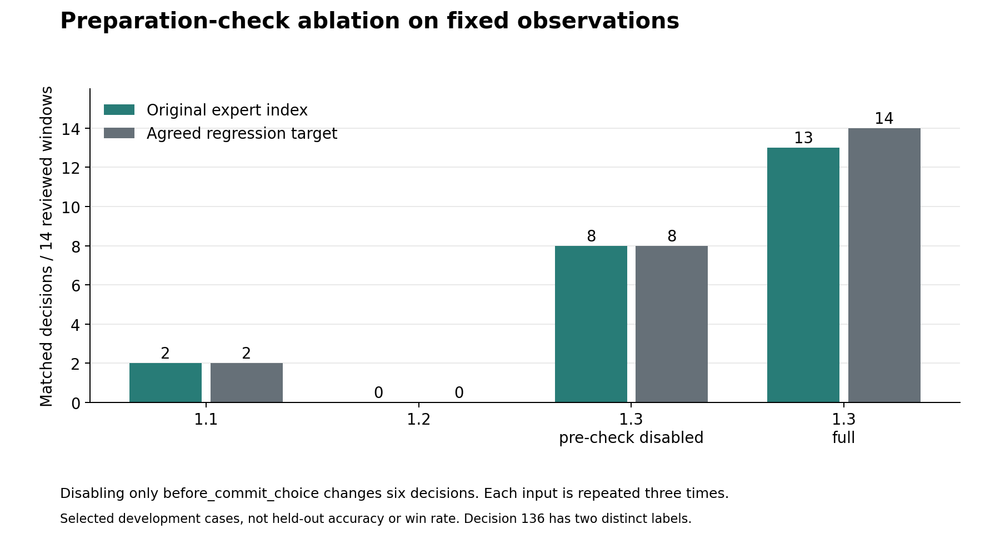

# From Legal Choices to Coherent Turns

*What three Pokemon TCG deck strategies taught us about sequencing, expert feedback and evaluation*

## 1. Discovering the Problem Across Decks

Why could an agent choose legal actions yet fail to play a useful turn? This
question connects our development of Hydreigon/Mega Gengar, N's Zoroark
and the Palafin ex deck. All use deterministic Python policies selecting from
the official cabt engine's legal options. Human battle reviews changed explicit
rules; no neural policy was trained and no language model ran during matches.

Hydreigon/Mega Gengar first exposed the difference between owning cards and
having a plan. A Stage 2 in hand made its missing evolution bridge valuable,
but only when its Basic could develop. The same principle changed discard
decisions: an unusable duplicate could be expendable, while the only
Basic-search card with an empty Bench was essential. We replaced unconditional
priorities with hand-and-board dependencies and protected resources needed
for the next action.

N's Zoroark added a second distinction: an attack source was not necessarily
an attacker. Pokemon supplying copied attacks should not automatically receive
Energy themselves. Separating those roles also required isolating deck
profiles. Otherwise, rules useful in one deck distorted another. Checking
the packaged policy, not just local code, became part of verification,
consistent with the deployment-testing emphasis of the ML Test Score.[^P12]

| Deck | Failure exposed | Strategic correction |
| --- | --- | --- |
| Hydreigon/Mega Gengar | Missing setup links; wasteful discards | Value prerequisites and protect usable combinations |
| N's Zoroark | Support roles confused with attackers | Allocate resources by deck-specific role |
| Palafin ex deck | Unproductive switching; preparation bypassed | Evaluate complete routes and recheck useful actions before committing |

The Palafin ex deck combined these problems into a sequencing test. Palafin ex offered 250 base damage for one Water. Accessing it through
Zero to Hero required moving normal Palafin from Active to Bench; repeating
Giga Impact then required resetting its attack restriction. Mega Dragonite ex
therefore served primarily as switching
support through Sky Transport. Dragonair searched evolutions; Tatsugiri with
Air Balloon supplied a return pivot. Dragonite remained a secondary attacker:
its 330-damage attack required Water and two Lightning, then discarded two
Energy. These were different roles and budgets, not interchangeable attackers.

An isolated switch could look unproductive while enabling the whole turn.
Conversely, rewarding movement indiscriminately created unnecessary retreats.
Our hypothesis became: score a route by its useful completion, checking the
destination, independent return and retreat limit. This resembles temporal
abstraction in the options framework, although our routes were hand-coded,
not learned options.[^P02] Switching was an engineering turning point, not
proof of a competitive breakthrough.

To inspect these chains, we built local replays and review of recorded legal
alternatives. An Apple Silicon compatibility issue required running the unchanged
Linux engine through Lima/Rosetta. Separating rules, policies and evaluation
also appears in OpenSpiel's architecture; our simulator still used cabt.[^P17]

Correctness evidence accumulated: focused rechecks passed 36 Hydreigon/Gengar
and 17 Zoroark tests. For the Palafin ex deck, earlier focused rechecks passed
10 tests and the later full suite passed 215. However, the player reported
1.21 weaker than 1.20 in the earlier development series. In the later series,
imported 1.3 won only one of three games against 1.2, going first in all
three.[^L1] These results forced the next question: did our corrections
change the intended decisions, and what would establish stronger play?

## 2. Testing Decisions Before Claiming Learning

The setup failures suggested testing incomplete openings rather than ideal
combinations. For B Basics in a uniformly shuffled 60-card deck,

$$P(\text{no Basic in seven})=\binom{60-B}{7}/\binom{60}{7}.$$

The current Palafin ex deck list has seven Basics, giving a 39.91% initial mulligan
probability. Among accepted opening sevens, only 5.88% naturally contain
Finizen, Dratini and Water together. These exact calculations exclude bonus
draws and searches. They do not measure deck strength, but explain why
recovering partial combinations must be a normal policy behavior.[^L2]

Even after setup, the board alone was insufficient. Giga Impact's restriction
depends on prior events, while hidden cards remain unknown. POMDP research
provides the conceptual reason to retain history; our event memory was not
an exact belief-state solver.[^P01] Battle 15 made the consequence visible:
12 of 41 observed main turns were pass-only. That symptom motivated inspecting
history, movement routes and preparation decisions, not assuming a timeout
or that every pass was erroneous.

The diagnosis found correct turn flags but a missed numeric attack event,
conflicting movement-target rules and refresh overblocking. A legal pass was
therefore a policy failure in these cases, not a frozen engine.[^L1]

We then asked whether the intended priorities actually controlled execution.
For recorded heuristic score s and selected action a_t, define

$$\delta_t=\max_a s_t(a)-s_t(a_t).$$

Across 2,075 eligible historical main-phase windows, 729 selected below the
recorded maximum: 35.13%. Eligibility required multiple options, one selected
index, complete finite scores and a matching trace. Pooling versions does not
establish an improvement curve. This is discordance,
not an error rate: deliberate guards can correctly override scores. Scores
are neither win probabilities nor learned Q-values.

Battle 24 decision 131 supplied an actionable example: an attack scored
-3,780, while Poffin scored 32,557.5 and was also the expert's choice.
The agent attacked. Another Poffin bonus would not repair a branch that
bypassed its score. Action-masking research supports restricting choices to
legal actions, but legality alone cannot guarantee strategic selection.[^P09][^L2]

To test that execution mechanism, we replayed 29 saved observations through
four archived-policy configurations, three repetitions each: 348 legal
selections. Disabling only the preparation hook in 1.3, which rechecks useful
actions before attacking or passing, changed six of 14 reviewed choices.
Full 1.3 matched all 14 regression targets and 13 original
expert indices; one target intentionally attached Energy before the annotated
Supporter. Without the hook, expert agreement was 8/14. Repetition checked
stability, not additional strategic examples.
The remaining 15 inputs came from battle 15's saved end-turn decisions.[^L2]

*Figure 1. Removing the preparation hook changes six reviewed choices.
Expert and regression labels differ once. These are selected development
cases, not win rates or independent samples from repeated calls.*

The ablation establishes an effect on those decisions, not on whole games:
alternative actions change future states, which fixed-input probes did not
simulate. Nor was this machine learning. Expert feedback still produced
programmed rules. Preference-learning research distinguishes such feedback
from a trained preference model.[^P23] Published demonstrations show what
training might add: human-preference RL reported feedback on under 1% of
environment interactions, and Deep TAMER reported 15 minutes of feedback
for Atari Bowling.[^P07][^P16] Neither supplies a Pokemon training budget.

Competitive evidence remained weaker. The audit validated 5,943 recorded
selections across 40 nonempty episodes, but two of 41 summaries lacked winners;
legal output also cannot exclude silent fallback. The 1/3 result has an
illustrative 95% Wilson interval of 6.1%-79.2%, assuming independent Bernoulli
outcomes and leaving sampling bias unresolved.[^L3] Agarwal and colleagues
investigated few-run uncertainty using five algorithms, 100 runs and 26 games;
Henderson and colleagues emphasize reproducible evaluation conditions.[^P13][^P14]
Our measurements therefore support a specific execution correction, not a
general strength claim. The next experiments must close that gap.

## 3. Three Experiments to Close the Gap

**First, test whether corrected decisions improve complete games.** Freeze
policy archives, deck lists, engine versions and seed sets. Compare full 1.3
with the preparation-disabled variant against identical opponent pools,
alternating first player. Retain losses and missing outcomes; report matchup
results, uncertainty, latency and fallback counts. Predefine the sample size
and promotion criteria rather than stopping after favorable games. Success
means a reproducible competitive benefit without increased failures, not
another perfect score on the 14 reviewed cases. This directly extends the
fixed-state ablation beyond its principal limitation: unobserved consequences.

**Second, test whether expert review can train a reusable preference.** Collect
alternative legal actions, the expert's goal and multiple acceptable choices
from states the agent actually visits, following DAgger's data-collection
motivation without claiming our current patches implement it.[^P05] A future
compact ranker could use RankNet-style pairwise loss:[^P08]

$$L(\theta)=-\sum_i\log\sigma(f_\theta(o_i,a_i^+)-f_\theta(o_i,a_i^-)).$$

Here a_i^+ is preferred to a_i^- and sigma is logistic. Split by complete
games, retain legality guards and verify the exported checkpoint through
the submission entry point. Success requires better held-out preference
agreement and full-game results than the frozen heuristic baseline. This
objective is proposed, not implemented, and does not directly predict wins.

**Third, test complete sequences rather than movement frequency.** Label the
goal, initiation conditions and completion of transformation or attacker-reset
routes. Include unavailable pivots, consumed retreat rights and missing return
options. Compare isolated action scoring with route-aware selection under
the same clock budget. Measure completed attack routes, wasted Energy and
unproductive loops; hold out deck interactions to test whether the improvement
extends beyond the Palafin ex deck. Success is reaching a useful attacker more reliably,
not switching more often. Together, these experiments turn the original
cross-deck lesson into an evaluation plan: legal actions must advance a
coherent strategy, and learning must improve behavior beyond the examples
that supplied its rules.

## Evidence and References

[^L1]: [Cross-deck evidence map](CROSS_DECK_EVIDENCE.md) and [performance audit](DATA_AUDIT.md): reported problems, source checks, test scope and recorded outcomes.
[^L2]: [Methods and results](SCIENTIFIC_METHODS_AND_RESULTS.md), [fixed-state probes](scientific_data/archive_probes.json) and [supporting data workbook](scientific_data/scientific_evidence.xlsx).
[^L3]: NIST/SEMATECH, [confidence intervals for a binomial proportion](https://www.itl.nist.gov/div898/handbook/prc/section2/prc241.htm).

[^P01]: Kaelbling, L. P.; Littman, M. L.; Cassandra, A. R. (1998). [Planning and acting in partially observable stochastic domains](https://cs.brown.edu/courses/csci2951-k/papers/kaelbling98.pdf). Artificial Intelligence 101:99-134.

[^P02]: Sutton, R. S.; Precup, D.; Singh, S. (1999). [Between MDPs and semi-MDPs: A framework for temporal abstraction in reinforcement learning](https://www.sciencedirect.com/science/article/pii/S0004370299000521). Artificial Intelligence 112:181-211.

[^P05]: Ross, S.; Gordon, G.; Bagnell, D. (2011). [A Reduction of Imitation Learning and Structured Prediction to No-Regret Online Learning](https://proceedings.mlr.press/v15/ross11a.html). AISTATS, PMLR 15:627-635.

[^P07]: Christiano, P. F., et al. (2017). [Deep reinforcement learning from human preferences](https://arxiv.org/abs/1706.03741). NeurIPS 30.

[^P08]: Burges, C., et al. (2005). [Learning to Rank using Gradient Descent](https://www.microsoft.com/en-us/research/publication/learning-to-rank-using-gradient-descent/). ICML 2005; Microsoft Research MSR-TR-2005-06.

[^P09]: Huang, S.; Ontanon, S. (2022). [A Closer Look at Invalid Action Masking in Policy Gradient Algorithms](https://arxiv.org/abs/2006.14171). FLAIRS 35; preprint 2020.

[^P12]: Breck, E.; Cai, S.; Nielsen, E.; Salib, M.; Sculley, D. (2017). [The ML Test Score: A Rubric for ML Production Readiness and Technical Debt Reduction](https://research.google/pubs/the-ml-test-score-a-rubric-for-ml-production-readiness-and-technical-debt-reduction/). IEEE Big Data 2017.

[^P13]: Agarwal, R.; Schwarzer, M.; Castro, P. S.; Courville, A.; Bellemare, M. G. (2021). [Deep Reinforcement Learning at the Edge of the Statistical Precipice](https://arxiv.org/abs/2108.13264). NeurIPS 34.

[^P14]: Henderson, P., et al. (2018). [Deep Reinforcement Learning That Matters](https://ojs.aaai.org/index.php/AAAI/article/view/11694). AAAI 32.

[^P16]: Warnell, G.; Waytowich, N.; Lawhern, V.; Stone, P. (2018). [Deep TAMER: Interactive agent shaping in high-dimensional state spaces](https://www.cs.utexas.edu/~pstone/Papers/bib2html/b2hd-AAAI18-Warnell.html). AAAI 32.

[^P17]: Lanctot, M., et al. (2019). [OpenSpiel: A Framework for Reinforcement Learning in Games](https://arxiv.org/abs/1908.09453). Research framework paper, arXiv:1908.09453.

[^P23]: Wirth, C.; Akrour, R.; Neumann, G.; Furnkranz, J. (2017). [A Survey of Preference-Based Reinforcement Learning Methods](https://jmlr.org/papers/v18/16-634.html). JMLR 18(136):1-46.
